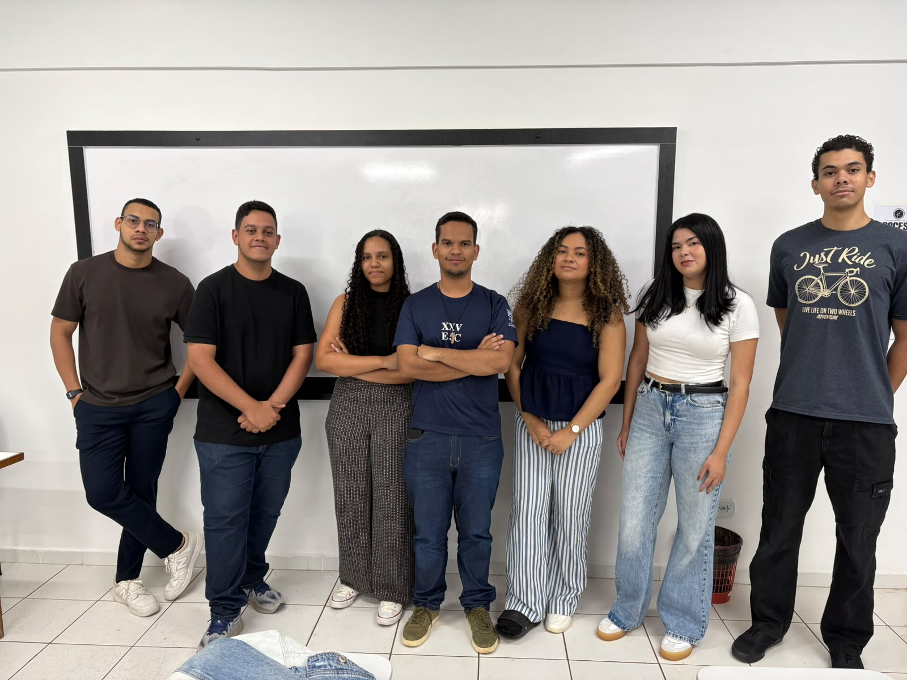

 

### App Android de conscientização, orientação e apoio a mulheres em situação de violência

Projeto Integrador do curso de **Engenharia de Software** · **UNICEPLAC** · Gama, DF · 2026

 

 

## 💜 O projeto

Muitas mulheres não reconhecem a violência que sofrem, não conhecem seus direitos e não sabem onde buscar ajuda gratuita. O **Vitórias** reúne tudo isso em um só lugar:

- 📖 **Informação e Direitos** — os cinco tipos de violência da Lei Maria da Penha e a legislação vigente, em linguagem simples
- 📍 **Rede de apoio** — Defensoria, Casa da Mulher Brasileira, CRM, CREAS, CAPS e DEAM mais próximos
- 🚨 **Emergência** — Ligue 180, 190 e Disque 100 a um toque
- 📝 **Denúncia** — ajuda a organizar o relato, salvo só no aparelho
- 🔒 **Privacidade** — sem cadastro, saída rápida e modo camuflado

 

 

## 👥 Equipe

 

| Integrante | Papel |
|---|---|
| Gabriel da Costa Vieira | Gerente de Projeto |
| [Matheus Matias Coutinho](https://github.com/MatheusMatiasCoutinho) | Tech Lead · Desenvolvedor Android · UI/UX |
| Vitória Emanuela da Silva Arfre Lopes | Desenvolvedora |
| Isaac dos Santos do Amaral | Analista de Requisitos |
| Thalita Kamille Soares Veras | Analista de Requisitos |
| Claudio Manoel Silva Dourado Morais | Tester |

**Orientador:** Prof. Romulo Valadares

 

> Em risco imediato, ligue **190**. Para orientação e denúncia, **Ligue 180**: gratuito, 24h, em todo o Brasil.

Feito com 💜 por estudantes de Engenharia de Software da UNICEPLAC

